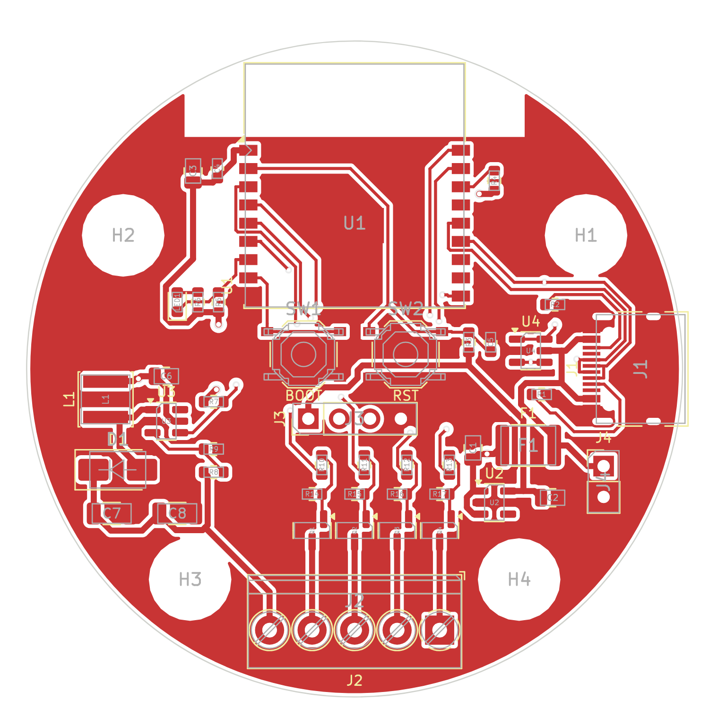

# Ping Lamp hardware: driver board and base for a Harmony XVU tower

Round driver PCB (54 mm) and a 3D-printed base ring (60 mm) that sit between a base plate and a
Schneider Electric Harmony XVU signal tower with 24 V AC/DC red, orange and green units.
One USB cable supplies the lamp and is also the programming port.




## Status

| Item | State |
|---|---|
| Netlist | Checked by script: schematic = PCB = `pcb/design.py` (131 pins) |
| Routing | Complete, 0 unconnected, 68 ground stitching vias |
| DRC (KiCad 7.0.11) | No clearance, short or edge errors. A few silkscreen notes. The 47 `lib_footprint_issues` entries in `pcb/fab/ping_lamp_drc.txt` only say that the build machine had no footprint library table. |
| Independent review | One review by a second reviewer without access to the design history; its findings are fixed or listed under "Open points" |
| Prototype | **None built.** Nothing here has been tested on hardware. |

Read "Open points" before ordering.

## Files

| Path | Content |
|---|---|
| [`docs/datasheet.md`](docs/datasheet.md) | Datasheet: ratings, electrical design values, connectors, mechanical data |
| [`docs/manual.md`](docs/manual.md) | Assembly and operating manual |
| `pcb/design.py` | Parts, netlist, placement, pre-laid tracks. Edit this, not the KiCad files. |
| `pcb/generate.py` | Builds schematic, routed PCB and `pcb/fab/` from `design.py` |
| `pcb/ping_lamp.kicad_*` | KiCad 7 project (generated) |
| `pcb/fab/ping_lamp_gerber.zip` | Gerber and drill files |
| `pcb/fab/ping_lamp_bom.csv`, `ping_lamp_cpl.csv` | Parts list and placement file in JLCPCB column layout |
| `pcb/fab/*.pdf` | Schematic and both copper sides |
| `enclosure/ping_lamp_base.scad` | Parametric base ring (OpenSCAD) |
| `enclosure/*.stl` | Tray and lid, exported with the default parameters |

## Circuit

| Block | Parts | Notes |
|---|---|---|
| Input | USB-C (J1), 5.1 k on CC1/CC2, PTC fuse 1.1 A (F1), USBLC6-2SC6 (U4) | Optional solder pads J4 "5V IN" in parallel to USB VBUS |
| 3.3 V | AP2112K-3.3 (U2) | Supplies the ESP32 module |
| 24 V | MT3608 boost (U3), 22 uH (L1), SS34 (D1), 390 k / 10 k divider | Vout = 0.6 V x (1 + 390/10) = 24.0 V. Enable is pulled down: the rail is **off until the firmware drives GPIO10 high** |
| Controller | ESP32-C3-WROOM-02-N4 (U1) | Native USB serial/JTAG on GPIO18/19, no USB-UART bridge |
| Outputs | 4 x AO3422 low-side (Q1..Q4), 100 R gate, 10 k pull-down | Tower common is +24 V, each tier returns through one MOSFET |

With the boost disabled the "+24V" terminal still carries about 4.5 V (USB voltage through L1
and D1). That is how a boost converter behaves; it is not a fault.

### GPIO map

| GPIO | Function |
|---|---|
| 4 | Green tier (Q1) |
| 5 | Orange tier (Q2) |
| 6 | Red tier (Q3) |
| 7 | AUX output (Q4), e.g. buzzer unit |
| 10 | Boost enable, high = 24 V on |
| 8 | Status LED, active low (strapping pin, pulled up) |
| 9 | BOOT button (SW1) |
| 0, 1 | Expansion header J3 (IO0, IO1, 3V3, GND), not populated |
| 2 | Pulled up (strapping pin) |

Firmware: in `ESP32/main.py` set `PIN_NUM_GREEN = 4`, `PIN_NUM_ORANGE = 5`, `PIN_NUM_RED = 6`,
`PIN_NUM_BOOST_EN = 10` and flash the MicroPython build for ESP32-C3. The defaults in that
file are for the breadboard version; on this board they would drive the USB pins.

### Terminal J2 (wire entry faces the board centre)

Seen from the component side with the terminal at the bottom, left to right:

| 24V | AUX | R | O | G |
|---|---|---|---|---|
| tower common | spare | red return | orange return | green return |

The labels are printed on both sides of the board.

### Power budget

| Case | 24 V load | USB current at 5 V (estimate) |
|---|---|---|
| One tier on (normal fade: duties add up to one tier) | 40 to 50 mA | 0.35 to 0.45 A |
| All three tiers on | about 140 mA | about 1.0 A |

- The whole 24 V rail, tiers and AUX together, is good for about 150 mA. Inductor (1.0 A rated)
  and fuse (1.1 A hold) set that limit.
- "All tiers on" is a test case, not a continuous mode: the fuse hold current drops in a warm,
  closed housing.
- AUX is meant for one more XVU unit (buzzer or fourth light, about 50 mA). An inductive load
  needs an external flyback diode.
- Tier currents are from Schneider datasheet extracts (XVUC23 max. 50 mA, XVUC24 max. 40 mA);
  the orange unit is assumed to be similar. Converter efficiency is assumed at 85 %.
- Use a charger rated for at least 1 A.

## Ordering the board

Placing the order is manual; nothing in this repository orders anything.

1. Upload `pcb/fab/ping_lamp_gerber.zip`. 2 layers, 1.6 mm, any colour.
2. Select SMT assembly, top side. Upload `ping_lamp_bom.csv` and `ping_lamp_cpl.csv`.
3. In the parts matching step, check every line against the "LCSC number check" column
   ("search snippet" = seen in a search result, not on the live page; "unchecked" = from memory).
   **Do not confirm the order with R8 (390 k) unmatched or substituted by another value.** R8
   sets the output voltage; without it the converter has no feedback and destroys itself.
4. Check the rotation of every polarised part in the placement preview. KiCad and JLCPCB use
   different zero-rotation conventions for some packages, and the placement file carries the
   KiCad values. U3 and U4 (SOT-23-6) are the critical ones: they also fit their pads when
   turned by 180 degrees, which reverses their supply pins. Pin 1 is marked on the silkscreen.
5. Solder by hand after delivery: J2 (5-position screw terminal, 3.5 mm pitch).
   J3 and J4 stay empty unless needed.

### Parts that are not on the board

| Qty | Part |
|---|---|
| 1 | Screw terminal block, 5 positions, 3.5 mm pitch, through-hole (Phoenix PT 1,5/5-3.5-H or equivalent; compare the footprint drawing) |
| 4 | Countersunk screw M3 x 25. Nylon at the two holes beside the antenna (H1, H2) reduces detuning |
| 2 | Countersunk wood screw 3.5 to 4 mm for the tray |
| n | Screws for the tower base according to the XVU base (default model: 3 x M4, at most 8 mm of thread below the tower base). Optional: M4 heat-set inserts |
| 1 | USB-C cable, right-angle plug recommended, and a USB charger of at least 1 A |
| - | 4 wires, 0.25 to 0.5 mm2, from J2 to the terminals in the tower base |

## Base ring

Stack from the base plate upwards: tray floor 3 mm, 4 mm clearance, PCB 1.6 mm, 11.5 mm
component space, lid 5.5 mm. Total 25.6 mm, diameter 60 mm.


- **Tray:** screwed to the base plate from the inside, USB opening 13 x 7.5 mm in the wall, with
  a recess above it so the PCB drops straight in.
- **Lid:** four spacer tubes press the PCB onto the tray bosses. The wall ends 0.2 mm below the
  lid so that the tubes, not the wall, take the screw force. The screw heads end up under the
  tower base.
- **Tower fixing:** the tower screws cut their own thread in the lid (`tower_fix = "thread"`),
  or go into heat-set inserts (`"insert"`). There are no loose nuts above the PCB.
- **Print:** tray as modelled, lid upside down (STL is already turned). No supports.
  0.2 mm layers, 3 or more perimeters, PETG or PLA.
- **Cable from below instead of a plug:** set `floor_cable_hole_d` and solder the cable to J4.

Assembly order: tray onto the base plate, PCB with the four tower wires already in J2 into the
tray, wires through the lid's centre hole, lid on with the four M3 screws, tower base onto the
lid, wires into the tower terminals.

BOOT and RESET sit under the centre hole. They are reachable with a thin rod while the tower
base is off. Keep the wire slack away from them: a wire resting on RESET holds the board in
reset.

**The tower interface values in the SCAD file are placeholders.** No dimension drawing of the
XVU base could be retrieved. Measure on the real base and set `tower_d`, `tower_cable_hole_d`,
`tower_bolt_count`, `tower_bolt_circle` and `tower_bolt_angle`, then export both parts again.
OpenSCAD stops with an error if a tower screw would hit a spacer tube. Keep tower screws out
of the +y direction as well; that is where the antenna is.

## Bring-up

1. Plug in USB without the tower connected. Measure 3.3 V at J3 (pin 3 to pin 4).
2. Hold BOOT, press RESET, release BOOT. Flash MicroPython for ESP32-C3.
3. In the REPL switch the rail on and measure 23 to 25 V between J2 "24V" and GND:
   `from machine import Pin; Pin(10, Pin.OUT, value=1)`
4. Copy the firmware with the four pin constants set as above.
5. Connect one tier only, tower common to "24V". If it stays dark with the output switched
   on, the unit is polarity sensitive in the other direction; see open points.
6. Test the fade. If the tier flickers or does not dim, lower `PWM_FREQUENCY` (100 to 200 Hz)
   or switch the firmware to stepped on/off states.

## Open points

| Topic | Risk |
|---|---|
| PWM dimming of XVU LED units | Schneider documents are silent. The units contain their own AC/DC input stage; a smooth green-orange-red fade is not guaranteed. **Test one unit with a MOSFET and a 24 V supply before ordering the board.** |
| Polarity | The board switches the negative side; common must accept +24 V. Unconfirmed for the XVU base in use. A base that needs common on 0 V cannot be driven by this board without changes. |
| No over-voltage clamp on the 24 V rail | If R8 is missing or open the boost converter runs away. Covered only by the BOM check above. |
| Placement rotations | Not corrected for JLCPCB conventions, because those could not be verified from here. Manual check in the preview is required. |
| Footprints of substitute parts | USB-C, tactile switch, inductor and module footprints are the KiCad library ones for the named parts; the LCSC parts were not checked against their drawings. |
| Datasheets | Manufacturer sites were not reachable. Not confirmed against a datasheet: AO3422 pin drawing (standard SOT-23 order assumed; order the genuine AOS part), MT3608 absolute maximum ratings and soft start. |
| Inrush at plug-in | About 50 uF sits behind the fuse. A weak USB port may briefly dip. The boost itself starts only when the firmware enables it. |
| Boost layout | Autorouted, not hand-optimised for switching-node area. EMC was not assessed. |
| Bottom ground plane | Cut by one 2.5 mm wide bundle of five signal tracks under the module and by the 5 V feed. Stitching vias sit on both sides. |
| Antenna | Ground pour starts 14 mm either side of the antenna, steel screws at H1/H2 are 13 mm away. A metal base plate would detune it further. |
| Thermal vias of the module pad | The 0.2 mm vias of the library footprint are removed; four 0.3 mm stitching vias sit around the pad instead. |

## Regenerating

Needs KiCad 7 with its Python module, Java, and a Freerouting jar (1.9.0 was used).

```bash
/usr/bin/python3 hardware/pcb/generate.py --freerouting /path/to/freerouting.jar
```

- The build happens in a scratch directory. The files in the repository are replaced only if
  the netlist check passes, nothing is unrouted and DRC shows no entry other than silkscreen
  notes. A rejected build prints `BUILD REJECTED` and leaves the repository untouched.
- The autorouter does not give the same result every run and can fail to complete a net.
  The 5 V feed, the reset line and the four gate lines are pre-laid in `design.py` for that
  reason. If a build is rejected, run it again or pre-lay the failing net.
- `--reuse-session` reuses the stored routing only if placement and netlist are unchanged.
- KiCad 7 has no command-line ERC; open the schematic in KiCad to run it.

```bash
openscad -D 'part="tray"' -o hardware/enclosure/ping_lamp_base_tray.stl hardware/enclosure/ping_lamp_base.scad
```

```bash
openscad -D 'part="lid"' -o hardware/enclosure/ping_lamp_base_lid.stl hardware/enclosure/ping_lamp_base.scad
```
