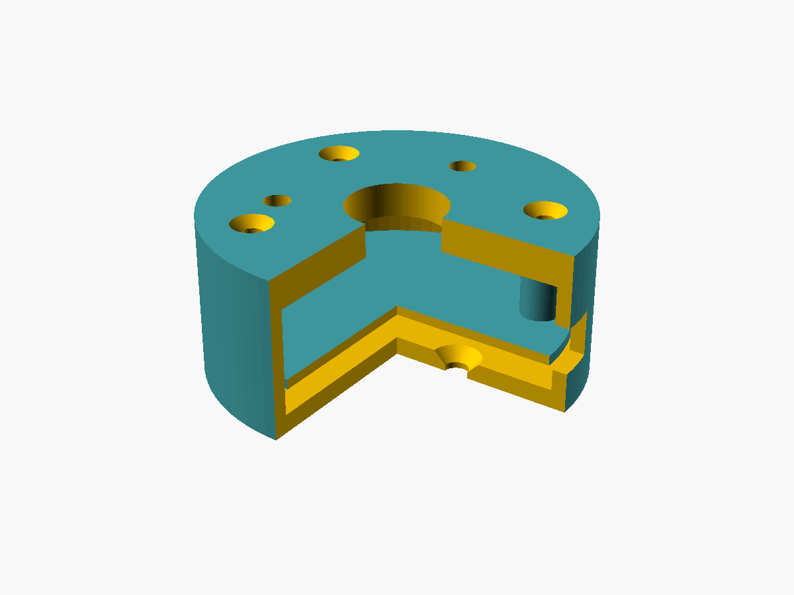
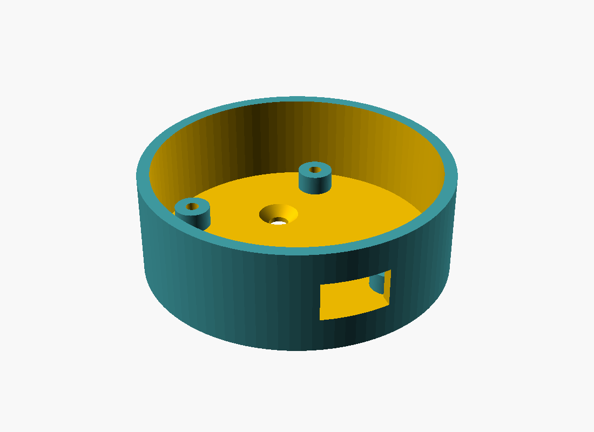

# Ping Lamp hardware: driver board and base for a Harmony XVU tower

Round driver PCB (54 mm) and a 3D-printed base ring (60 mm) that sit between a base plate and a
Schneider Electric Harmony XVU signal tower with 24 V AC/DC red, orange and green units.
One USB cable supplies the lamp and is also the programming port.




## Status

| Item | State |
|---|---|
| Netlist | Checked by script: schematic = PCB = `pcb/design.py` (131 pins) |
| Routing | Complete, 0 unconnected |
| DRC (KiCad 7.0.11) | No clearance, short or edge errors. 3 silkscreen notes. The 47 `lib_footprint_issues` entries in `pcb/fab/ping_lamp_drc.txt` only say that the build machine had no footprint library table. |
| Prototype | **None built.** Nothing here has been tested on hardware. |
| Design review by a second person | Not done |

Read "Open points" before ordering.

## Files

| Path | Content |
|---|---|
| `pcb/design.py` | Parts, netlist, placement. Edit this, not the KiCad files. |
| `pcb/generate.py` | Builds schematic, routed PCB and `pcb/fab/` from `design.py` |
| `pcb/ping_lamp.kicad_*` | KiCad 7 project (generated) |
| `pcb/fab/ping_lamp_gerber.zip` | Gerber and drill files |
| `pcb/fab/ping_lamp_bom.csv`, `ping_lamp_cpl.csv` | Parts list and placement file in JLCPCB column layout |
| `pcb/fab/*.pdf` | Schematic and both copper sides |
| `enclosure/ping_lamp_base.scad` | Parametric base ring (OpenSCAD) |
| `enclosure/*.stl` | Tray and lid, exported with the default parameters |

## Circuit

| Block | Parts | Notes |
|---|---|---|
| Input | USB-C (J1), 5.1 k on CC1/CC2, PTC fuse 1.1 A (F1), USBLC6-2SC6 (U4) | Optional solder pads J4 "5V IN" in parallel to USB VBUS |
| 3.3 V | AP2112K-3.3 (U2) | Supplies the ESP32 module |
| 24 V | MT3608 boost (U3), 22 uH (L1), SS34 (D1), 390 k / 10 k divider | Vout = 0.6 V x (1 + 390/10) = 24.0 V. Enable pin pulled up, so the 24 V rail is on by default |
| Controller | ESP32-C3-WROOM-02-N4 (U1) | Native USB serial/JTAG on GPIO18/19, no USB-UART bridge |
| Outputs | 4 x AO3422 low-side (Q1..Q4), 100 R gate, 10 k pull-down | Tower common is +24 V, each tier returns through one MOSFET |

### GPIO map

| GPIO | Function |
|---|---|
| 4 | Green tier (Q1) |
| 5 | Orange tier (Q2) |
| 6 | Red tier (Q3) |
| 7 | AUX output (Q4), e.g. buzzer unit |
| 10 | Boost enable: drive low to switch the 24 V rail off |
| 8 | Status LED, active low (strapping pin, pulled up) |
| 9 | BOOT button (SW1) |
| 0, 1 | Expansion header J3 (3V3, IO0, IO1, GND), not populated |
| 2 | Pulled up (strapping pin) |

`ESP32/main.py` was written for a classic ESP32. For this board change
`PIN_NUM_GREEN = 4`, `PIN_NUM_ORANGE = 5`, `PIN_NUM_RED = 6` and flash the MicroPython build
for ESP32-C3.

### Terminal J2 (wire entry faces the board centre)

Seen from the component side with the terminal at the bottom, left to right:

| +24V | G | O | R | AUX |
|---|---|---|---|---|
| tower common | green return | orange return | red return | spare |

The same labels are on the bottom silkscreen.

### Power budget

| Case | 24 V load | USB current at 5 V (estimate) |
|---|---|---|
| One tier on (normal fade: duties add up to one tier) | 40 to 50 mA | 0.35 to 0.45 A |
| All three tiers on | about 140 mA | about 1.0 A |

Tier currents are from Schneider datasheet extracts (XVUC23 max. 50 mA, XVUC24 max. 40 mA);
the orange unit is assumed to be similar. Converter efficiency is assumed at 85 %.
Use a charger rated for at least 1 A. AUX: resistive or electronic loads up to 0.5 A; an
inductive load needs an external flyback diode.

## Ordering the board

Placing the order is manual; nothing in this repository orders anything.

1. Upload `pcb/fab/ping_lamp_gerber.zip`. 2 layers, 1.6 mm, any colour.
2. Select SMT assembly, top side. Upload `ping_lamp_bom.csv` and `ping_lamp_cpl.csv`.
3. In the parts matching step, check every line against the "LCSC number check" column:
   - "search snippet": the number was seen in a search result, not on the live page.
   - "unchecked": MT3608 (C84817) is from memory.
   - "select manually": 390 k 0603 1 % resistor has no number.
4. Check the rotation of J1, U1..U4, Q1..Q4, D1 and LED1 in the placement preview. KiCad and
   JLCPCB use different zero-rotation conventions for some packages.
5. Solder by hand after delivery: J2 (5-position screw terminal, 3.5 mm pitch).
   J3 and J4 stay empty unless needed.

### Parts that are not on the board

| Qty | Part |
|---|---|
| 1 | Screw terminal block, 5 positions, 3.5 mm pitch, through-hole (Phoenix PT 1,5/5-3.5-H or equivalent; compare the footprint drawing) |
| 4 | Countersunk screw M3 x 25 (nylon screws at the two holes next to the antenna reduce detuning) |
| 2 | Countersunk wood screw 3.5 to 4 mm for the tray |
| n | Screws and nuts for the tower base, according to the XVU base (default model: 3 x M4) |
| 1 | USB-C cable, right-angle plug recommended, and a USB charger of at least 1 A |
| - | 4 wires, 0.25 to 0.5 mm2, from J2 to the terminals in the tower base |

## Base ring

Stack from the base plate upwards: tray floor 3 mm, 4 mm clearance, PCB 1.6 mm, 11.5 mm
component space, lid 5.5 mm. Total 25.6 mm, diameter 60 mm.



- **Tray:** screwed to the base plate from the inside, USB opening 13 x 7.5 mm in the wall.
- **Lid:** four spacer tubes press the PCB onto the tray bosses. The screw heads end up under
  the tower base. The centre hole passes the tower wires and gives access to BOOT and RESET.
- **Print:** tray as modelled, lid upside down (STL is already turned). No supports.
  0.2 mm layers, 3 or more perimeters, PETG or PLA.
- **Cable from below instead of a plug:** set `floor_cable_hole_d` and solder the cable to J4.

**The tower interface values in the SCAD file are placeholders.** No dimension drawing of the
XVU base could be retrieved. Measure on the real base and set `tower_d`, `tower_cable_hole_d`,
`tower_bolt_count`, `tower_bolt_circle`, `tower_bolt_d` and `tower_bolt_angle`, then export
both parts again. Keep the tower screws clear of the spacer tubes (22 mm radius at 30, 150,
232 and 308 degrees).

## Bring-up

1. Before the tower is connected: plug in USB, measure 3.3 V at J3 and 24 V (23 to 25 V)
   between J2 "+24V" and GND (J3 pin 4).
2. Hold BOOT, press RESET, release BOOT. Flash MicroPython for ESP32-C3, then copy the
   firmware with the new pin numbers.
3. Connect one tier only, tower common to "+24V". If it stays dark with the output switched
   on, the unit is polarity sensitive in the other direction; see open points.
4. Test the fade. If the tier flickers or does not dim, lower `PWM_FREQUENCY` (100 to 200 Hz)
   or switch the firmware to stepped on/off states.

## Open points

| Topic | Risk |
|---|---|
| PWM dimming of XVU LED units | Schneider documents are silent. The units contain their own AC/DC input stage; a smooth green-orange-red fade is not guaranteed. |
| Polarity | The board switches the negative side; common must accept +24 V. Unconfirmed for the XVU base in use. A base that needs common on 0 V cannot be driven by this board without changes. |
| Footprints of substitute parts | USB-C, tactile switch, inductor and module footprints are the KiCad library ones for the named parts; the LCSC parts were not checked against their drawings. |
| MT3608 data | Pinout confirmed by search results, the 0.6 V reference and the LCSC number are from memory. |
| AO3422 pinout | Standard SOT-23 order (1 gate, 2 source, 3 drain) assumed; not confirmed against the AOS drawing. Order the genuine AOS part, clones differ. |
| Boost layout | Generated by an autorouter, not hand-optimised for switching-node area. Expect it to work at this power level; EMC was not assessed. |
| Tracks under the module | A few signal tracks run on the top layer under the ESP32 module body (not under the antenna). |
| Thermal vias of the module pad | Removed (0.2 mm drills). The centre pad is still soldered to ground on the top layer. |

## Regenerating

Needs KiCad 7 with its Python module, Java, and a Freerouting jar (1.9.0 was used).

```bash
/usr/bin/python3 hardware/pcb/generate.py --freerouting /path/to/freerouting.jar
```

The autorouter is not deterministic in every detail; check that the script reports
`unrouted connections: 0` and review the DRC summary after each run.

```bash
openscad -D 'part="tray"' -o hardware/enclosure/ping_lamp_base_tray.stl hardware/enclosure/ping_lamp_base.scad
```

```bash
openscad -D 'part="lid"' -o hardware/enclosure/ping_lamp_base_lid.stl hardware/enclosure/ping_lamp_base.scad
```
