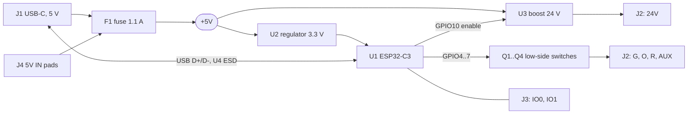
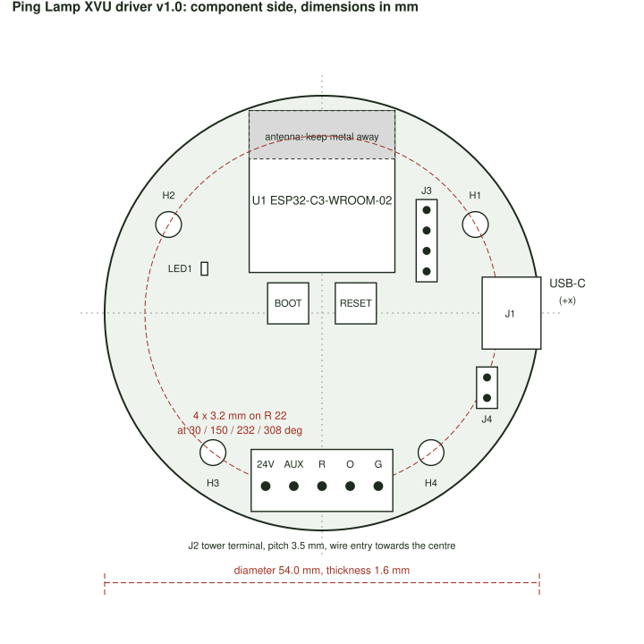
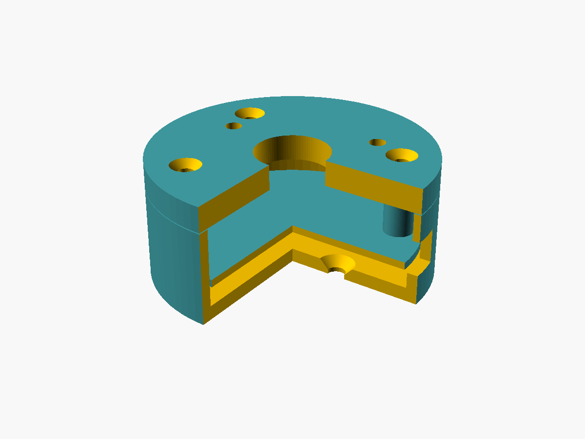
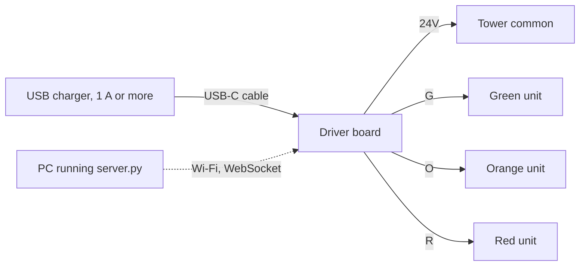

# Ping Lamp XVU Driver: Datasheet

| | |
|---|---|
| Product | USB-powered driver board and base ring for a Schneider Electric Harmony XVU signal tower |
| Board revision | v1.0 |
| Document revision | A, preliminary |
| Design data | `hardware/pcb/design.py` |

> **Preliminary.** No board has been built. Every electrical value in this document is a design
> value: calculated from the circuit or taken from component data. Nothing has been measured.
> Values marked (c) come from component manufacturer or distributor data, values marked (d) are
> derived by calculation, values marked (e) are estimates.

## 1. Description

The board turns a three-tier 24 V signal tower into a desk lamp that shows network latency. It
takes 5 V from one USB-C cable, generates the 24 V the tower needs, and switches up to four
tower units with PWM from an ESP32-C3 Wi-Fi module. The same USB port is the programming and
console port. The board is round, 54 mm, and sits in a printed ring of tower diameter between
the tower and a base plate.

### Features

- Single USB-C connection: supply and USB serial console
- On-board 5 V to 24 V boost converter, switched by the controller, off after reset
- Four low-side switched outputs (green, orange, red, auxiliary), PWM capable
- ESP32-C3-WROOM-02-N4: 2.4 GHz Wi-Fi and Bluetooth LE, 4 MB flash, PCB antenna (c)
- Resettable input fuse, ESD protection on the USB lines
- BOOT and RESET buttons, status LED, 4-pin expansion header, alternative 5 V solder pads
- Assembly on one side, 40 SMD parts, 2-layer board

### Intended use

Indoor indicator lamp at safety extra-low voltage. It is not a safety or alarm signalling
device and has not been assessed against any standard for one.

## 2. Block diagram

The tower common wire connects to "24V". Each tier returns through one switch to ground.

## 3. Absolute maximum ratings

Exceeding these values can damage the board.

| Parameter | Max. | Limiting part |
|---|---|---|
| Voltage at J1 VBUS or J4 | 6.0 V | U2 input (c) |
| Voltage applied from outside to any J2 terminal | none permitted | J2 is an output |
| Voltage at J3 IO0, IO1 | 3.6 V | U1 supply range (c) |
| Total current from the 24 V rail | 170 mA | L1, F1 (d) |
| Voltage rating of the output switches | 55 V | Q1..Q4 (c) |
| Voltage rating of the 24 V rail parts | 40 V | D1 (c) |

## 4. Recommended operating conditions

| Parameter | Min. | Nom. | Max. | Unit |
|---|---|---|---|---|
| Supply voltage, VBUS | 4.75 | 5.0 | 5.25 | V |
| Supply current capability of the source | 1.0 | | | A |
| Total load on the 24 V rail, continuous | | 50 | 150 | mA |
| External load on J3 3V3 | | | 50 | mA (e) |
| Ambient temperature | not characterised; intended for room temperature | | | |

## 5. Electrical characteristics

VBUS = 5 V, room temperature, unless noted.

### 5.1 Supply

| Parameter | Value | Basis |
|---|---|---|
| Input current, one tier on at full brightness | 0.35 to 0.45 A | (e) |
| Input current, three tiers on | about 1.0 A | (e) |
| Input fuse F1 | 1.1 A hold, 2.2 A trip, resettable | (c) |
| Capacitance behind the fuse at plug-in | about 50 uF nominal | (d) |
| 3.3 V regulator U2 | 3.3 V, 600 mA rating | (c) |

The estimates assume 40 to 50 mA per tier (c, XVUC23 and XVUC24; the orange unit is assumed
to be similar) and 85 % converter efficiency. In normal operation the firmware fades between
two neighbouring tiers whose duty cycles add up to one tier.

### 5.2 24 V rail

| Parameter | Value | Basis |
|---|---|---|
| Output voltage, enabled | 24.0 V nominal, 23.0 to 25.0 V | (d) 0.6 V x (1 + 390 k / 10 k); reference 2 %, resistors 1 % |
| Output voltage, disabled | about 4.5 V | (d) VBUS through L1 and D1 |
| Switching frequency | 1.2 MHz | (c) |
| Continuous output current | 150 mA | (d) |
| Enable input | GPIO10, high = on, 100 k pull-down | design |
| State after reset or while flashing | off | design |
| Over-voltage protection | none | see section 9 |

### 5.3 Switched outputs G, O, R, AUX

| Parameter | Value | Basis |
|---|---|---|
| Type | N-channel MOSFET to ground (low side) | design |
| Control | GPIO4 (G), GPIO5 (O), GPIO6 (R), GPIO7 (AUX), high = on | design |
| On-resistance | below 0.2 ohm at 2.5 V gate drive | (c) |
| Voltage drop at 50 mA | below 10 mV | (d) |
| State after reset | off, 10 k gate pull-down | design |
| PWM frequency used by the firmware | 1 kHz | `ESP32/main.py` |
| Flyback diode | none; inductive loads need an external diode | design |
| Short-circuit protection | none per channel; input fuse only | design |

### 5.4 Controller and interfaces

| Parameter | Value | Basis |
|---|---|---|
| Module | ESP32-C3-WROOM-02-N4, RISC-V, 4 MB flash | (c) |
| Radio | 2.4 GHz Wi-Fi 802.11 b/g/n, Bluetooth LE 5 | (c) |
| USB | USB 2.0 full speed, built-in USB serial/JTAG | (c) |
| USB-C configuration | 5.1 k on CC1 and CC2 (power sink, no Power Delivery) | design |
| Logic level | 3.3 V, not 5 V tolerant | (c) |
| ESD protection | USBLC6-2SC6 on D+, D- and VBUS | design |

## 6. Connectors, controls, indicators

Reference frame for all positions: component side up, origin at the board centre, x to the
right (towards the USB connector), y up (towards the antenna). Dimensions in mm.

### J1: USB-C receptacle

At the +x rim, opening outwards. Supply input and USB data.

### J2: tower terminal

5-position screw terminal, 3.5 mm pitch, pins at y = -21.5. Wire entry faces the board centre.
Hand-soldered through-hole part. Labels are printed on both board sides.

| Label | x | Net | Function |
|---|---|---|---|
| 24V | -7.0 | +24V | Tower common |
| AUX | -3.5 | OUT_AUX | Spare switched return |
| R | 0.0 | OUT_R | Red tier return |
| O | 3.5 | OUT_O | Orange tier return |
| G | 7.0 | OUT_G | Green tier return |

### J3: expansion header (not populated)

1 x 4, 2.54 mm pitch, at x = 13.0. Labels on the bottom side.

| Pin | y | Signal |
|---|---|---|
| 1 | 12.8 | IO0 (GPIO0) |
| 2 | 10.26 | IO1 (GPIO1) |
| 3 | 7.72 | 3V3 |
| 4 | 5.18 | GND |

### J4: alternative 5 V input (not populated)

Two solder pads at x = 20.5 for a supply cable that enters through the base plate. Pin 1
(y = -8.0, square pad) is +5 V and joins VBUS ahead of the fuse; pin 2 (y = -10.54) is GND.
Do not feed J4 and J1 from two different supplies at the same time.

### Controls and indicator

| Item | Position | Function |
|---|---|---|
| SW1 BOOT | (-4.2, 1.2) | GPIO9. Held during reset: USB download mode |
| SW2 RESET | (4.2, 1.2) | Restarts the controller |
| LED1 | (-14.6, 5.5) | Red, between 3.3 V and GPIO8, lit when GPIO8 is low. Not used by the current firmware |

### GPIO summary

| GPIO | Use | GPIO | Use |
|---|---|---|---|
| 0, 1 | J3 | 8 | LED1, strapping, pulled up |
| 2 | Strapping, pulled up | 9 | BOOT button, strapping |
| 3 | Not connected | 10 | 24 V enable |
| 4, 5, 6, 7 | G, O, R, AUX | 18, 19 | USB D-, D+ |
| | | 20, 21 | Not connected |

## 7. Mechanical data

### Board

| Parameter | Value |
|---|---|
| Outline | Circular, diameter 54.0 mm |
| Thickness, layers | 1.6 mm, 2 copper layers |
| Mounting holes | 4 x 3.2 mm (M3), unplated, on a 22 mm radius at 30, 150, 232 and 308 degrees |
| Hole centres (x, y) | H1 (19.05, 11.0), H2 (-19.05, 11.0), H3 (-13.54, -17.34), H4 (13.54, -17.34) |
| Keep-out around each hole | 3.4 mm radius, no copper |
| Component height above the board | 9.2 mm at J2 (c); all other parts about 3.3 mm or less (nominal part heights, e) |
| Protrusion below the board | J2 pins, about 2.9 mm (c) |
| Antenna | At the +y rim; no copper on either layer below it |
| Mass | not determined |

### Base ring (default parameters of `enclosure/ping_lamp_base.scad`)

| Parameter | Value |
|---|---|
| Outer diameter x height | 60 mm x 25.6 mm |
| Parts | Tray (floor 3 mm, wall 2.4 mm) and lid (5.5 mm) |
| Stack | floor 3.0, clearance 4.0, board 1.6, component space 11.5, lid 5.5 mm |
| USB opening | 13 x 7.5 mm in the wall at +x |
| Lid centre hole | 16 mm, for the tower wires and access to the buttons |
| Fasteners | 4 x M3 x 25 countersunk through lid, spacer tubes and board into the tray |
| Tower fixing | Placeholder: 3 x M4 on a 36 mm circle. Must be set to the measured XVU base |

## 8. Typical application

Tower: Harmony XVU with 24 V AC/DC LED units. Units for 100 to 240 V AC must not be connected.

## 9. Limitations and unverified points

| Topic | Statement |
|---|---|
| Measurements | None. No prototype exists. |
| PWM dimming of XVU units | Not confirmed by Schneider documents. The units have their own input stage; smooth dimming is not guaranteed. |
| Polarity | The board needs a tower whose common accepts +24 V. Not confirmed for the XVU base. |
| XVU supply tolerance | Not confirmed; the calculated 23 to 25 V has not been compared with a Schneider figure for this series. |
| 24 V over-voltage | No clamp. If feedback resistor R8 is missing or open, the converter output rises until parts fail. |
| EMC, radio, safety | Not assessed. The radio module has its own approvals; the assembled product has none. |
| Temperature range | Not characterised. The fuse hold current falls with temperature; printed PLA softens well below 100 degrees C. |
| Component data | Manufacturer sites were not reachable during design. Not confirmed against a manufacturer datasheet: AO3422 pin drawing, MT3608 reference tolerance and absolute ratings. |
| Tower interface of the base ring | Placeholder dimensions. |

## 10. Ordering information

The board is not a stocked product. It is fabricated from the files in `hardware/pcb/fab/`.

| Item | File or part |
|---|---|
| Bare board | `ping_lamp_gerber.zip`: 2 layers, 1.6 mm |
| Assembly data | `ping_lamp_bom.csv`, `ping_lamp_cpl.csv` (JLCPCB column layout), top side only |
| Hand-soldered part | J2: 5-position screw terminal, 3.5 mm pitch, Phoenix PT 1,5/5-3.5-H or equivalent |
| Printed parts | `enclosure/ping_lamp_base_tray.stl`, `enclosure/ping_lamp_base_lid.stl` |

Ordering steps and checks are in the [manual](manual.md), section 3.

## 11. Revision history

| Revision | Change |
|---|---|
| A | First issue, for board v1.0. Preliminary, design values only. |
